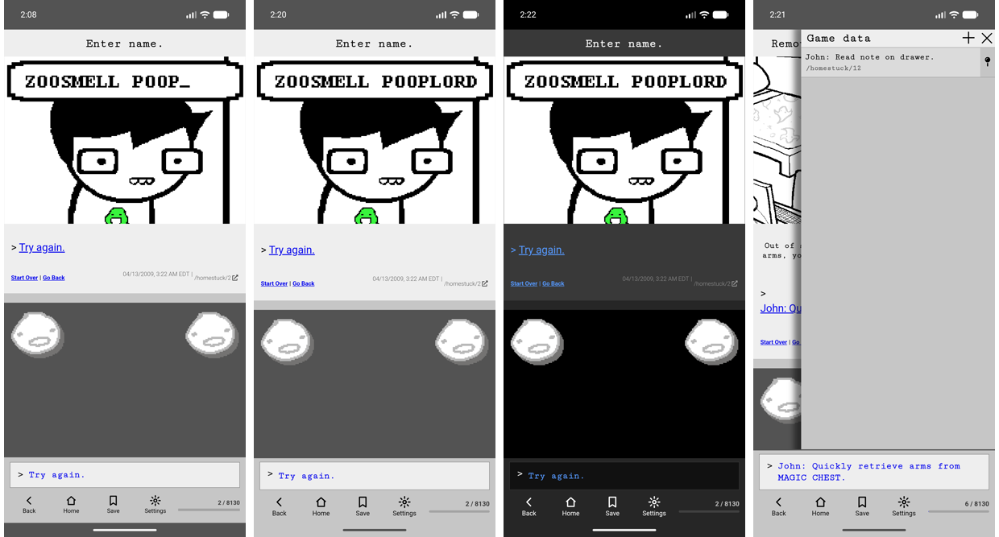
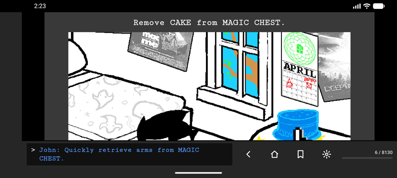
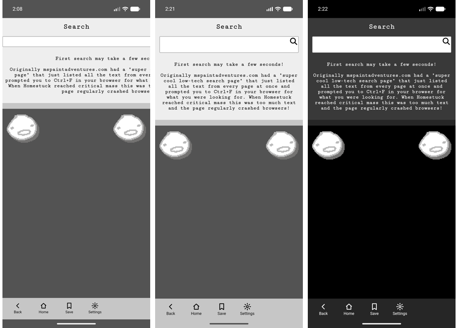
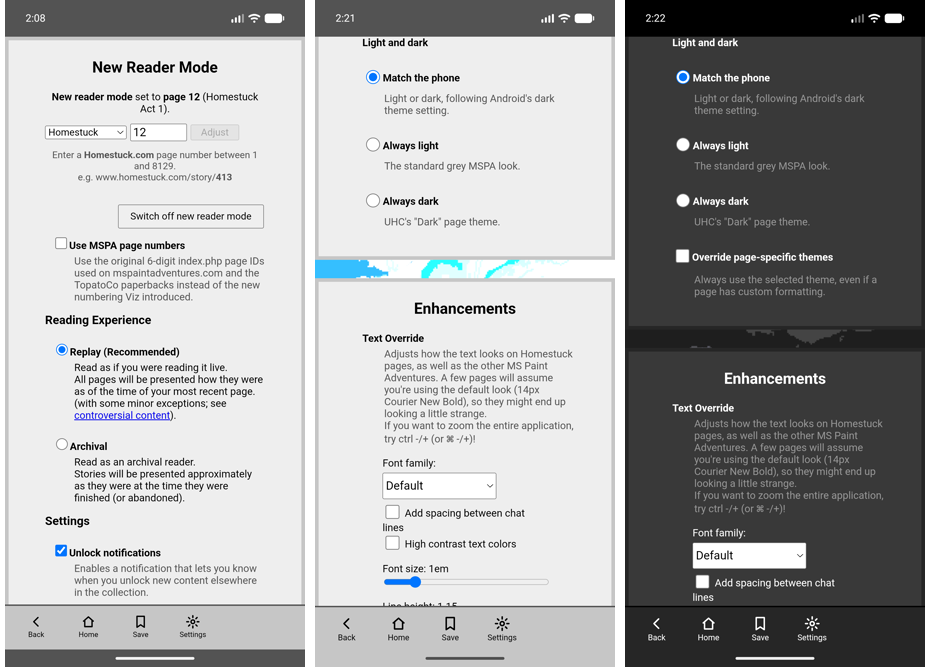
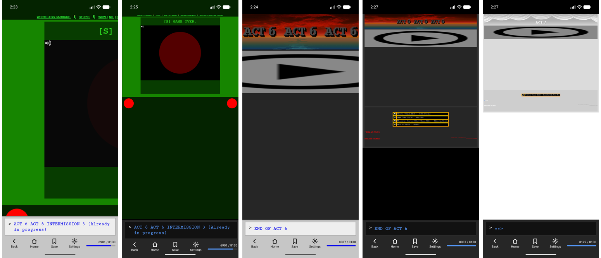
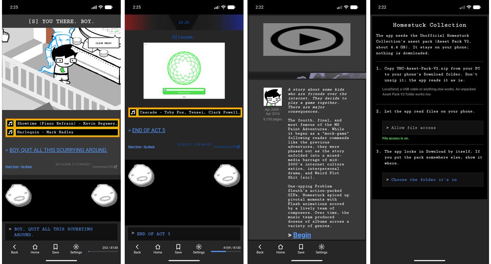

# Audit report: UHC for Android, 2.8.1-android.6

Scope: the shim (`shim/uhc-shim.js`), the phone layer (`shim/mobile.js`, `shim/mobile.css`), the Java
WebView app (`android/`), the setup page, CI and docs. Brief: [docs/prompts/professional-audit.md](../prompts/professional-audit.md).

Tested on the `UHC_Android17` emulator (Android 17 / API 37, 1080×2400, 420 dpi), with the real 4.4 GB
pack zip read in place, in light and dark mode, portrait and landscape.

## Performance

Measured with `node tools/perf.mjs 7` (median of 7 cold starts, 70 page turns), both builds with the
same script on the same emulator and pack:

| | Before (android.5) | After (android.6) | |
|---|---|---|---|
| Cold start → first panel decoded, reader bar shown | 3537 ms | **2324 ms** | −34% |
| Page turn (reader-bar tap → next panel decoded) | 16 ms | 16 ms | same |
| Page turn, 90th percentile | 18 ms | 20 ms | noise |
| JS heap after the run | 65 MB | 61 MB | |

Where the cold-start time went, and what changed:

| Boot step (ms after the page starts) | Before | After |
|---|---|---|
| Archive JSON (13 MB) requested | 990 (after the mods load) | 235 (as the shim loads) |
| `mspa.json` (10 MB) transfer | 840 | ~620 (64 KiB buffered reads) |
| `epilogues.yaml` (1.6 MB) sync reads | 3 × ~170 | 1 × ~177 (text cache) |
| First story panel decoded | ~2230 | ~1450 |

About 1 s before the page starts is Android starting the process and the WebView; the app can't change that.
Page turns were already fast and are unchanged. The `fitMedia` MutationObserver work is now cached per
element, so it no longer clears and re-measures every panel on each DOM change.

## Findings

Severity: **High** = broken for some users or a security issue; **Medium** = visible bug or a big
speed/UX cost; **Low** = polish and hygiene.

### High

| # | Finding | Status |
|---|---|---|
| H1 | The theme's parent, `Theme.DeviceDefault.DayNight`, only exists from Android 10, so the app could not start on Android 8–9 although `minSdk` is 26 (found by Android lint). | Fixed: `values/` and `values-v29/` themes. |
| H2 | A `Range` header with a huge number threw `NumberFormatException` inside `shouldInterceptRequest`, which crashes the app. Any page script could send one. | Fixed, with tests for every Range form. |
| H3 | The `UHCNative` bridge is visible to every script in the page, including JS from the asset pack and its mods. Any of it could open the folder picker, the all-files settings screen, reset the pack choice (`forgetPack`), or launch any URI scheme through `openExternal`. | Fixed: setup actions only work while the setup page shows; `openExternal` only opens http(s) and mailto; `forgetPack` removed. |
| H4 | Flash pages with their own layout ran off the screen: [S] GAME OVER (950 px `.A6A6` frame), [S] Collide and [S] Act 7 (983 px custom pages). This breaks the "panels and Flash fit the width" rule. | Fixed: bare Flash embeds and over-wide custom blocks are zoomed to fit, keeping their shape. |

### Medium

| # | Finding | Status |
|---|---|---|
| M1 | Slow cold start (see Performance). | Fixed, −34%. |
| M2 | Pages built for desktop widths overflowed at 411 px: Search (450 px box, 600 px results), Settings button row (400 px), News, Home rows. | Fixed in `mobile.css`. |
| M3 | Moving, deleting or replacing the pack while the app was in the background left it serving errors. | Fixed: checked on resume; back to setup. |
| M4 | UHC saves progress 1 s after a page turn; if Android ended the app inside that second, the page was lost. | Fixed: saved immediately when the app is backgrounded. The WebView still takes about 1–2 s to write to disk, which the app can't control. |
| M5 | With the Dark theme, the Home logo (a looping video) stayed paused, showing Android's play icon. | Fixed: autoplay videos start once. |
| M6 | A video page's reused Flash frame (650 → 950 px) wasn't refitted, because the fit cache only looked at child count. Found while testing this pass. | Fixed. |
| M7 | No manual light/dark choice. | Added to UHC's own Settings page (Application Theme), styled like its neighbours. It replaces UHC's "Dark Mode" checkbox. |
| M8 | Status and navigation bar colours were fixed at launch, and in light mode a dark-grey strip sat under the light reader bar. | Fixed: both follow the active UHC theme, with matching light/dark system icons. |
| M9 | The screen could time out during a long Flash. | Fixed: kept on while a Flash/video page is open. |
| M10 | Back used `onBackPressed`, which Android stops calling once the app targets API 36. | Fixed: `OnBackInvokedCallback` on Android 13+. |

### Low

| # | Finding | Status |
|---|---|---|
| L1 | Reader bar: 44 px targets, 10 px labels, no pressed state, and the page progress had no accessible name. | 48 dp targets, 11 px labels, pressed states, clearer button labels, progress exposed as a progress bar. |
| L2 | A quick double tap on "next" could skip a page. | Second tap within 250 ms is ignored. |
| L3 | Landscape: the two-row bar took about a third of the screen. Wide screens stretched story text. | One-row bar in landscape; story column centred at ≤760 px. |
| L4 | On pages with their own colours (Cascade, Act 6), the bar switched to light while the reader uses Dark. | Bar keeps the reader's theme. |
| L5 | Setup page: no feedback while checking, no specific message for a zip still copying, 44 px buttons. | Fixed. |
| L6 | Launcher icon not adaptive, no splash. | Adaptive and themed icon, Android 12+ splash, all from UHC's icon. |
| L7 | `usesCleartextTraffic` allowed plain http everywhere. | Network security config: only 127.0.0.1 and mspaintadventures.com. |
| L8 | Dead code (`skipFully`, a second `Bounded`, `sortedNames`, `empty`, `forgetPack`) and the deprecated `setDatabaseEnabled`. | Removed. |
| L9 | No tests, no lint, CI only built. | JVM tests (17), Node tests (11), ESLint, Android lint (`abortOnError`), all in CI. |
| L10 | Flash links to other pages left the app (desktop UHC opens them in place). | Opened in the app via UHC's own URL resolver. |

### Checked and fine
- `PackServer`/`PackSource` thread safety: the zip index is built once and only read afterwards; each
  open stream has its own file handle. 404, 416 and path traversal (`..`) are handled; HEAD and listings
  match `tools/dev-server.mjs`.
- A zip that is still copying has no end record, so it is rejected until complete; the setup page says so.
- Rotation doesn't recreate the activity (`configChanges`), and now dark-mode switches don't either; the
  page updates live.
- Process death: UHC restores its tabs from localStorage on the next launch.
- `assets://` and old-URL coverage matches Electron's `webRequest` list in UHC's `background.js`
  (mspaintadventures.com, asset.uhc, sweetcred, and the four old mp3 hosts).
- No `INTERNET` permission: nothing can leave the phone; external links open in the browser.
- Flash sample (Ruffle): [S] YOU THERE. BOY. (audio confirmed playing), [S] Jade: Descend, [S] Cascade,
  [S] Caliborn: Enter, [S] GAME OVER, [S] Collide, [S] Act 7. All fit the width after this pass.

## Left as is, and why

- **All-files access (`MANAGE_EXTERNAL_STORAGE`).** A narrower option exists (see Decisions); it changes
  setup, so it's the owner's call.
- **No "go to page" box on the phone.** The desktop address bar/jumpbox is hidden with the header. A new
  control is a design change (see Decisions).
- **Synchronous XHRs at boot.** UHC's mod loader uses Node's synchronous `fs` API, so the shim must answer
  synchronously. They are now cached and few (about 30 small requests).
- **`mspa.json` parse on the main thread** (~50 ms). Parsing in a worker would cost about the same to copy back.
- **[S] Collide and [S] Act 7** are scaled as whole pages, so their small text is smaller still; this keeps
  their shape as required. Their videos show the WebView's play poster until tapped.
- **Reader-bar Back** uses the page's own "Go Back" link, which UHC implements as a new page visit; so
  Android back after it returns to the page you came from. This is UHC's behaviour, unchanged.
- **The bridge is still visible to every frame.** Restricting it by origin needs AndroidX
  (`WebViewCompat.addWebMessageListener`); with no INTERNET permission and the H3 limits, the remaining
  exposure (status, links, bar colours, keep-screen-on) is harmless.
- **Not tested:** a physical tablet or foldable (landscape on the phone emulator only), and TalkBack
  with a screen reader running (labels and roles were checked in the DOM).

## Screenshots

Reader bar: before (light), after light, after dark, Save panel.

Landscape, dark: one-row bar.

Search: before, after light, after dark.

Settings → Application Theme: before, after light, after dark.

Flash fit: [S] GAME OVER before/after, [S] Collide before/after, [S] Act 7 after.

[S] YOU THERE. BOY., [S] Cascade, Home (Dark theme), setup page (dark).

